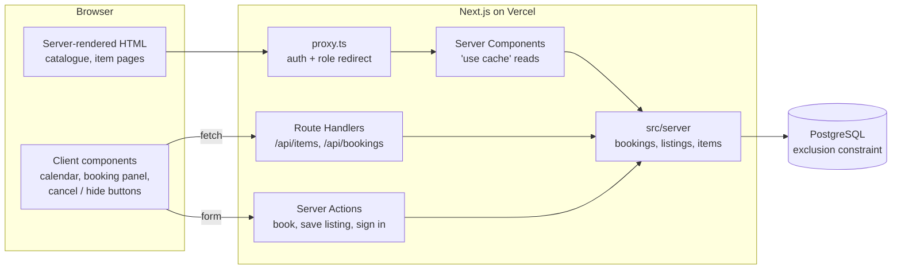

# Lendlot

A peer-to-peer rental marketplace: people list things they own (drills, tents, cameras, PA speakers…) and others rent them by the day.

**Live demo:** _coming soon (Vercel + Neon)_

| Demo account          | Role   | Password       |
| --------------------- | ------ | -------------- |
| `renter@lendlot.test` | Renter | `lendlot-demo` |
| `owner@lendlot.test`  | Owner  | `lendlot-demo` |
| `admin@lendlot.test`  | Admin  | `lendlot-demo` |

## What it does

- **Catalogue** with full-text search, category filters and pagination — all state lives in the URL.
- **Item pages** with SEO/Open Graph metadata, structured data, and an accessible **availability calendar**.
- **Booking**: pick a date range → live price (10% off for 7+ days) → confirm. Double-booking is impossible, enforced by **PostgreSQL itself**.
- **Accounts and roles**: renters book, owners manage their own listings, admins manage users.
- **Dashboards**: "My bookings" (with cancellation) and "My listings" (create, edit, hide).
- **REST API** for items and bookings, used by the client components.

## Tech stack

Next.js 16 (App Router, Cache Components) · React 19 · TypeScript (strict) · Tailwind CSS 4 · PostgreSQL 17 + Prisma 7 · Auth.js v5 · Zod 4 · Vitest + React Testing Library · Playwright + axe · Docker Compose · GitHub Actions · Vercel + Neon

## Architecture



```
prisma/              schema, migrations (incl. the hand-written constraint), seed
src/app/             routes: pages, layouts, Server Actions, Route Handlers
src/components/      UI (catalogue, booking, dashboard, forms)
src/lib/             pure logic shared by client and server: dates, pricing, Zod schemas
src/server/          server-only code: Prisma client, services, auth helpers
src/proxy.ts         Next 16 "middleware": protects /dashboard and /admin
tests/integration/   booking rules + concurrency against real Postgres
tests/e2e/           Playwright user journeys + axe accessibility checks
```

Pages, Server Actions and Route Handlers are thin: they parse input with Zod, check who the user is, and call a service in `src/server`. All business rules (ownership, cancellation, pricing, conflicts) live in those services, so the UI and the API can't drift apart.

## Key decisions

### Double-booking is prevented by the database, not just the app

The obvious approach — "check whether the dates are free, then insert" — has a race condition. Two requests can both run the check, both see the dates as free, and both insert. Adding more app servers makes it worse.

Instead, the `Booking` table has a PostgreSQL **exclusion constraint** ([migration](prisma/migrations/20261013082305_booking_no_overlap/migration.sql)):

```sql
CREATE EXTENSION IF NOT EXISTS btree_gist;

ALTER TABLE "Booking" ADD CONSTRAINT "booking_no_overlap"
  EXCLUDE USING gist ("itemId" WITH =, daterange("startDate", "endDate", '[]') WITH &&)
  WHERE ("status" = 'CONFIRMED');
```

It reads: _"no two confirmed rows may have the same item **and** overlapping date ranges."_ Postgres enforces this atomically using an index, however many requests arrive at once. `btree_gist` is needed so that one GiST index can combine equality on `itemId` with range overlap (`&&`). The `WHERE` clause means cancelled bookings free their dates.

The app therefore does **no** availability pre-check before inserting. It inserts, and if Postgres raises `23P01 exclusion_violation`, the service turns it into a friendly "those dates were just booked" message. An [integration test](tests/integration/concurrency.test.ts) fires 25 overlapping bookings at the same moment and asserts that exactly one succeeds and 24 get a conflict.

Prisma's schema language can't express exclusion constraints, so this lives in a hand-written migration. `prisma migrate diff` confirms Prisma leaves it alone.

### Server Components by default, client components only where needed

- The catalogue, item pages and dashboards are **Server Components**: they query the database directly, ship no JavaScript for their content, and are fast to first paint and easy for search engines.
- **Client components** are used only for real interactivity: the calendar (keyboard navigation and selection), the live price preview, and the cancel/hide buttons.
- Search is a plain `GET` form (upgraded by `next/form`), so filtering works even before JavaScript loads.

### Server Actions for forms, Route Handlers for the API

- **Server Actions** handle form submissions (book, sign in/up, save a listing). They run only on the server, validate with Zod, and work as progressive enhancement: the booking form posts even without JavaScript. The **price is always recomputed on the server**; the client's preview is never trusted.
- **Route Handlers** (`/api/items`, `/api/bookings`) are a small REST API. Client components use them for live data that the cached page can't contain (availability) and for in-place updates (cancel a booking, hide a listing). They share the same services and Zod schemas as the actions.

### Caching and ISR with Cache Components

Next 16's Cache Components are enabled. Public reads are `"use cache"` functions with a `cacheLife` (time-based revalidation) and `cacheTag`s (on-demand revalidation). Item pages are prerendered for the newest items via `generateStaticParams`; other items are rendered on first visit and then cached — that is ISR in Next 16. Editing a listing calls `updateTag`, so the owner immediately sees their change.

Because the item page is cached, **availability is never baked into it**: the calendar fetches `/api/items/:id/availability` fresh. The only per-user part of the layout (the header's account menu) streams in behind `<Suspense>`, so it doesn't make every page dynamic.

### Authorisation: defence in depth

- `proxy.ts` (Next 16's renamed middleware) redirects signed-out users away from `/dashboard` and `/admin` and checks roles. It's a fast first gate, **not** the security boundary.
- Every page, Server Action and Route Handler checks again, and the role is **re-read from the database** rather than trusted from the session token. Role changes therefore take effect immediately.
- Owner writes go through one function that loads the item **scoped to the owner**. Another owner's item behaves exactly like a missing one (404), so ids can't be probed.

### Smaller decisions

- **Money is integer cents** — no floating-point rounding errors.
- **Dates are ISO strings (`2026-10-13`) with UTC arithmetic** — bookings are whole days, and this avoids "off by one day" timezone bugs. Postgres stores them as `DATE`.
- **Passwords** use Node's built-in `scrypt`, so there's no native dependency to break serverless builds.
- **Item images are generated** by a [script](scripts/generate-item-images.ts) rather than taken from stock photos: no licensing questions, no brand logos, works offline in CI.

## Accessibility

- Labels on every input, `aria-invalid` + `aria-describedby` for errors, and **focus moves to the first invalid field** after a failed submit.
- The calendar follows the WAI-ARIA grid pattern: one tab stop, arrow keys, Home/End, PageUp/PageDown. Booked days stay focusable and are announced as "booked" rather than silently disabled.
- Skip link, visible focus ring, live regions for result counts and calendar messages.
- Playwright runs **axe** (WCAG 2.1 A/AA) on the main pages in CI.

## Running locally

Requirements: Node 22+, Docker.

```bash
npm install
cp .env.example .env          # then set AUTH_SECRET (npx auth secret)
npm run db:up                 # Postgres 17 on localhost:5433 (+ a test database)
npx prisma migrate deploy     # create tables and the exclusion constraint
npm run db:seed               # 24 sample listings + demo accounts
npm run dev                   # http://localhost:3000
```

## Tests

| Command                              | What it runs                                                                                  |
| ------------------------------------ | --------------------------------------------------------------------------------------------- |
| `npm test`                           | Unit + component tests (Vitest, React Testing Library, jsdom)                                 |
| `npm run test:integration`           | Booking rules, ownership and the **concurrency test** against the real Postgres test database |
| `npm run test:e2e`                   | Playwright: builds the app, seeds the test DB, runs the user journeys + axe checks            |
| `npm run lint` / `npm run typecheck` | ESLint / TypeScript                                                                           |

GitHub Actions runs all of the above on every push and pull request ([workflow](.github/workflows/ci.yml)).

## Deployment

Vercel hosts the app; Neon provides Postgres (it supports `btree_gist`). The `vercel-build` script runs `prisma migrate deploy` before `next build`. Required environment variables: `DATABASE_URL` (pooled), `DATABASE_URL_UNPOOLED` (direct, used for migrations), `AUTH_SECRET`.
