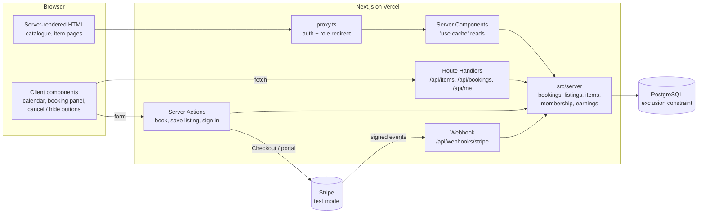

# Lendlot

A peer-to-peer rental marketplace: people list things they own (drills, tents, cameras, PA speakers…) and others rent them by the day.

**Live demo:** https://lendlot.vercel.app

| Demo account          | Role   | Password       |
| --------------------- | ------ | -------------- |
| `renter@lendlot.test` | Renter | `lendlot-demo` |
| `owner@lendlot.test`  | Owner  | `lendlot-demo` |
| `admin@lendlot.test`  | Admin  | `lendlot-demo` |

## What it does

- **Catalogue** with full-text search, category filters and pagination — all state lives in the URL.
- **Item pages** with SEO/Open Graph metadata, structured data, and an accessible **availability calendar**.
- **Booking**: pick a date range → live price (10% off for 7+ days) → confirm. Double-booking is impossible, enforced by **PostgreSQL itself**.
- **Accounts and roles**: renters book, owners manage their own listings, admins manage users.
- **Dashboards**: "My bookings" (with cancellation), "My listings" (create, edit, hide) and an owner **earnings** dashboard (earned to date, upcoming revenue, revenue by month, upcoming bookings).
- **Membership**: a monthly subscription through **Stripe Checkout** (test mode) that gives 15% off every rental, kept in sync by an **idempotent webhook**.
- **REST API** for items and bookings, used by the client components.

## Tech stack

Next.js 16 (App Router, Cache Components) · React 19 · TypeScript (strict) · Tailwind CSS 4 · PostgreSQL 17 + Prisma 7 · Auth.js v5 · Zod 4 · Stripe (test mode) · Vitest + React Testing Library · Playwright + axe · Docker Compose · GitHub Actions · Vercel + Neon

## Architecture



```
prisma/              schema, migrations (incl. the hand-written constraint), seed
src/app/             routes: pages, layouts, Server Actions, Route Handlers
src/components/      UI (catalogue, booking, dashboard, forms)
src/lib/             pure logic shared by client and server: dates, pricing, Zod schemas
src/server/          server-only code: Prisma client, services, auth helpers
src/proxy.ts         Next 16 "middleware": protects /dashboard and /admin
tests/integration/   booking rules, concurrency, ownership, earnings, Stripe webhook (real Postgres)
tests/e2e/           Playwright user journeys + axe accessibility checks
```

Pages, Server Actions and Route Handlers are thin: they parse input with Zod, check who the user is, and call a service in `src/server`. All business rules (ownership, cancellation, pricing, conflicts) live in those services, so the UI and the API can't drift apart.

## Key decisions

### Double-booking is prevented by the database, not just the app

The obvious approach — "check whether the dates are free, then insert" — has a race condition. Two requests can both run the check, both see the dates as free, and both insert. Adding more app servers makes it worse.

Instead, the `Booking` table has a PostgreSQL **exclusion constraint** ([migration](prisma/migrations/20261013082305_booking_no_overlap/migration.sql)):

```sql
CREATE EXTENSION IF NOT EXISTS btree_gist;

ALTER TABLE "Booking" ADD CONSTRAINT "booking_no_overlap"
  EXCLUDE USING gist ("itemId" WITH =, daterange("startDate", "endDate", '[]') WITH &&)
  WHERE ("status" = 'CONFIRMED');
```

It reads: _"no two confirmed rows may have the same item **and** overlapping date ranges."_ Postgres enforces this atomically using an index, however many requests arrive at once. `btree_gist` is needed so that one GiST index can combine equality on `itemId` with range overlap (`&&`). The `WHERE` clause means cancelled bookings free their dates.

The app therefore does **no** availability pre-check before inserting. It inserts, and if Postgres raises `23P01 exclusion_violation`, the service turns it into a friendly "those dates were just booked" message. An [integration test](tests/integration/concurrency.test.ts) fires 25 overlapping bookings at the same moment and asserts that exactly one succeeds and 24 get a conflict.

Prisma's schema language can't express exclusion constraints, so this lives in a hand-written migration. `prisma migrate diff` confirms Prisma leaves it alone.

**A race CI caught:** when overlapping inserts arrive at exactly the same instant, each can wait for the other's uncommitted row while checking the constraint, and Postgres resolves that deadlock by aborting one (`40P01`, reported by Prisma as `P2034`) after a 1-second wait, instead of raising `23P01`. No double booking gets through either way, but users would see errors. Retrying alone didn't fix it: under a burst the retries kept deadlocking each other. The fix is a short transaction that first locks the item row (`SELECT ... FOR UPDATE`), so concurrent bookings of the **same item queue up** and each hits the constraint cleanly, while different items still book in parallel. The constraint is still what guarantees correctness; the lock just makes conflicting writers line up, and a small deadlock retry remains as a safety net.

### Server Components by default, client components only where needed

- The catalogue, item pages and dashboards are **Server Components**: they query the database directly, ship no JavaScript for their content, and are fast to first paint and easy for search engines.
- **Client components** are used only for real interactivity: the calendar (keyboard navigation and selection), the live price preview, and the cancel/hide buttons.
- Search is a plain `GET` form (upgraded by `next/form`), so filtering works even before JavaScript loads.

### Server Actions for forms, Route Handlers for the API

- **Server Actions** handle form submissions (book, sign in/up, save a listing). They run only on the server, validate with Zod, and work as progressive enhancement: the booking form posts even without JavaScript. The **price is always recomputed on the server**; the client's preview is never trusted.
- **Route Handlers** (`/api/items`, `/api/bookings`) are a small REST API. Client components use them for live data that the cached page can't contain (availability) and for in-place updates (cancel a booking, hide a listing). They share the same services and Zod schemas as the actions.

### Caching and ISR with Cache Components

Next 16's Cache Components are enabled. Public reads are `"use cache"` functions with a `cacheLife` (time-based revalidation) and `cacheTag`s (on-demand revalidation). Item pages are prerendered for the newest items via `generateStaticParams`; other items are rendered on first visit and then cached — that is ISR in Next 16. Editing a listing calls `updateTag`, so the owner immediately sees their change.

Because the item page is cached, **availability is never baked into it**: the calendar fetches `/api/items/:id/availability` fresh. The only per-user part of the layout (the header's account menu) streams in behind `<Suspense>`, so it doesn't make every page dynamic.

### Authorisation: defence in depth

- `proxy.ts` (Next 16's renamed middleware) redirects signed-out users away from `/dashboard` and `/admin` and checks roles. It's a fast first gate, **not** the security boundary.
- Every page, Server Action and Route Handler checks again, and the role is **re-read from the database** rather than trusted from the session token. Role changes therefore take effect immediately.
- Owner writes go through one function that loads the item **scoped to the owner**. Another owner's item behaves exactly like a missing one (404), so ids can't be probed.

### Stripe webhooks are idempotent and order-independent

Stripe delivers webhooks **at least once** and **in no guaranteed order**, so the [handler](src/server/membership.ts) is built for both:

- **Signature first.** The raw request body is verified against the `Stripe-Signature` header before anything is trusted.
- **Idempotent.** Each event's id is inserted into a `StripeEvent` table **in the same database transaction** as the change it causes. A redelivered event, or two copies arriving at once, hits the primary key and is skipped, all or nothing. The handler only answers 2xx after the commit, so Stripe's retries are always safe.
- **Out-of-order safe.** Each update records the Stripe timestamp of the state it wrote, and the write is a compare-and-set: an older event that arrives late can't overwrite newer state (e.g. a stale "active" after a "cancelled").
- **No race on sign-up.** The Stripe customer is created (with an idempotency key, so a double-click can't create two) and linked to the user **before** Checkout starts, so every subscription event can find its user. On return from Checkout the subscription is also fetched and applied immediately, so the member doesn't wait for the webhook.
- **The discount is decided on the server** from the database (`ACTIVE` and the paid period not yet over), never from the client, and a missed "subscription deleted" event can't grant the discount forever.

Integration tests send signed and forged requests to the real route: activation, past due, cancellation, sequential and simultaneous duplicates, and out-of-order delivery. The app refuses live Stripe keys, so it can only ever run in test mode.

### Smaller decisions

- **Money is integer cents** — no floating-point rounding errors.
- **Dates are ISO strings (`2026-10-13`) with UTC arithmetic** — bookings are whole days, and this avoids "off by one day" timezone bugs. Postgres stores them as `DATE`.
- **Passwords** use Node's built-in `scrypt`, so there's no native dependency to break serverless builds.
- **Item images are generated** by a [script](scripts/generate-item-images.ts) rather than taken from stock photos: no licensing questions, no brand logos, works offline in CI.

## Accessibility

- Labels on every input, `aria-invalid` + `aria-describedby` for errors, and **focus moves to the first invalid field** after a failed submit.
- The calendar follows the WAI-ARIA grid pattern: one tab stop, arrow keys, Home/End, PageUp/PageDown. Booked days stay focusable and are announced as "booked" rather than silently disabled.
- Skip link, visible focus ring, live regions for result counts and calendar messages.
- Playwright runs **axe** (WCAG 2.1 A/AA) on the main pages in CI.

## Lighthouse

Measured on the live site by a [GitHub Actions workflow](.github/workflows/lighthouse.yml) that runs after every production deploy (Lighthouse 12, median of 3 runs, on GitHub's runners):

| Page                                                                    | Device  | Performance | Accessibility | Best practices | SEO |
| ----------------------------------------------------------------------- | ------- | ----------- | ------------- | -------------- | --- |
| [Catalogue](https://lendlot.vercel.app/)                                | Mobile  | 99          | 100           | 100            | 100 |
| [Catalogue](https://lendlot.vercel.app/)                                | Desktop | 100         | 100           | 100            | 100 |
| [Item page](https://lendlot.vercel.app/items/cordless-drill-driver-kit) | Mobile  | 97          | 100           | 100            | 100 |
| [Item page](https://lendlot.vercel.app/items/cordless-drill-driver-kit) | Desktop | 100         | 100           | 100            | 100 |

Measured on 2026-10-13. The workflow's job summary and HTML reports have the latest numbers.

## Running locally

Requirements: Node 22+, Docker.

```bash
npm install
cp .env.example .env          # then set AUTH_SECRET (npx auth secret)
npm run db:up                 # Postgres 17 on localhost:5433 (+ a test database)
npx prisma migrate deploy     # create tables and the exclusion constraint
npm run db:seed               # 24 sample listings + demo accounts
npm run dev                   # http://localhost:3000
```

Membership is optional locally. To try it, put a Stripe **test** secret key in `.env` as `STRIPE_SECRET_KEY` and run `npm run stripe:setup`, which creates the $9/month price and the billing portal and prints `STRIPE_PRICE_ID`. To receive webhooks on localhost, use the Stripe CLI (`stripe listen --forward-to localhost:3000/api/webhooks/stripe`) and set `STRIPE_WEBHOOK_SECRET` to the secret it prints. Test card: `4242 4242 4242 4242`, any future date and CVC.

## Tests

| Command                              | What it runs                                                                                  |
| ------------------------------------ | --------------------------------------------------------------------------------------------- |
| `npm test`                           | Unit + component tests (Vitest, React Testing Library, jsdom)                                 |
| `npm run test:integration`           | Booking rules, ownership, earnings, the Stripe webhook and the **concurrency test** against real Postgres |
| `npm run test:e2e`                   | Playwright: builds the app, seeds the test DB, runs the user journeys + axe checks            |
| `npm run lint` / `npm run typecheck` | ESLint / TypeScript                                                                           |

GitHub Actions runs all of the above on every push and pull request ([workflow](.github/workflows/ci.yml)), and Lighthouse after every production deploy.

## Deployment

Vercel hosts the app; Neon provides Postgres (it supports `btree_gist`). The `vercel-build` script runs `prisma migrate deploy` before `next build`. Required environment variables: `DATABASE_URL` (pooled), `DATABASE_URL_UNPOOLED` (direct, used for migrations) and `AUTH_SECRET`. For membership also `STRIPE_SECRET_KEY` (test mode), `STRIPE_PRICE_ID` and `STRIPE_WEBHOOK_SECRET`; `npm run stripe:setup -- --webhook-url=https://<domain>/api/webhooks/stripe` registers the production webhook endpoint.
